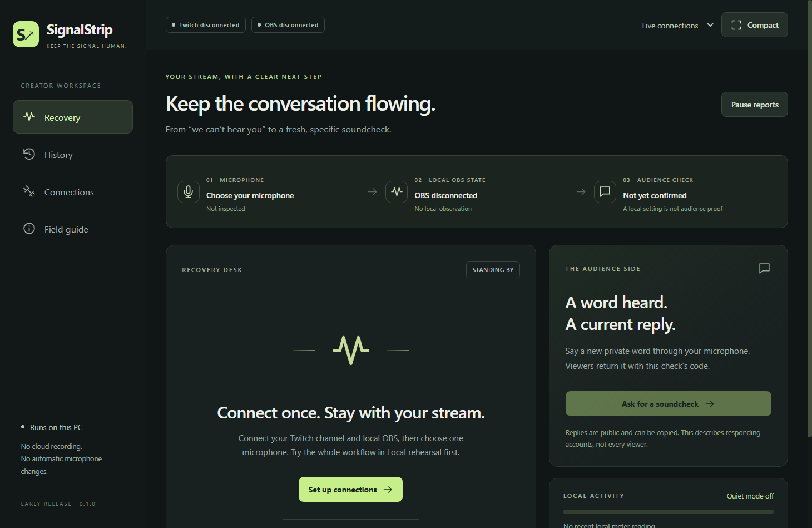

# SignalStrip

**A viewer report. A reviewed microphone correction. A fresh soundcheck.**

SignalStrip is a Windows companion for OBS and Twitch. When a viewer types `!signal audio`, it opens an incident, inspects one selected microphone, and lets the creator review an explicit correction. A fresh private spoken word and public check code separate current replies from stale “sounds good” messages.



No paid inference, hosted backend, viewer installation, stream key, or bot posting is required. This is a local desktop app.

## Run

Extract the Windows x64 ZIP into a writable folder, then run **SignalStrip.exe**. Keep its supporting files together. The portable app saves private data in **SignalStripData** beside the executable; exclude that folder when sharing the app. This early release is unsigned; Windows may show a reputation warning. Verify its supplied SHA-256 or inspect/build the source. Running SignalStrip requires no administrator rights. An optional OBS firewall rule is a separate administrator operation.

Source build on Windows with Node **24.18.1**, npm **11.16.0**:

```powershell
npm ci
npm run check
npm start
```

The first Electron launch may download its pinned runtime from the official Electron distribution. The lockfile and a narrowly pinned npm install-script allowlist are included.

```powershell
npm run test:ui     # isolated Electron rehearsal; no accounts required
npm run package     # Windows x64 portable ZIP in release/
```

## First run

1. Try **Local rehearsal**. Click **Viewer reports audio**, **Review unmute**, **Unmute selected mic**, then **Ask for a soundcheck**. Fixtures never change real OBS or post to Twitch.
2. Return to **Live connections**. Under **Connections**, connect Twitch with a Public Client ID and approve the device code as the broadcaster. Only `user:read:chat` is requested.
3. Connect OBS's authenticated WebSocket server. Restrict incoming access to this PC; a loopback client address does not restrict OBS's own listener.
4. Select your microphone capture source. Renamed/deleted sources require reselection.
5. Add the public card URL as an OBS **Browser Source**, **1280 × 240**. Keep the private creator window outside the broadcast capture.

Detailed instructions: [SETUP.md](docs/SETUP.md).

## Recovery loop

| Step | Behavior |
|---|---|
| Report | Viewer sends exactly `!signal audio`. Chat cannot write to OBS. |
| Inspect | Read selected mic mute state, tracks, and supported monitoring state. |
| Review | Review source and before/after values. Re-read before an explicit Set, then read back. |
| Check | Say the private word through the actual microphone. Viewers reply `!heard CODE word`. The public card never reveals the word. |
| Close | Choose current word returned, local correction only, unresolved, or dismissed. |

**OBS 33:** its old Monitor Only output behavior was removed. SignalStrip disables that legacy repair on 33+, retaining the unmute → readback → fresh-check workflow. Compatible earlier versions can restore the creator's intended output-capable monitor mode. The installed version actually tested is OBS **33.0.0 / WebSocket 5.7.6**; older monitoring repair is not a claimed installed-version test.

Local state does not prove delivered audio. Current-word replies describe responding accounts, are public/copyable, and cannot establish every viewer's experience. Reports during a check remain visible. A chat gap invalidates the check. An unknown setter result requires inspection; it is never blindly repeated. Restart restores history without replaying effects.

## Privacy and handoff

Windows-backed Electron safeStorage protects saved credentials. Arbitrary chat text, audio recordings, private words, stream keys, and whole OBS configurations are not persisted. Local moderation references are keyed pseudonyms; exports omit account IDs and source names. Closed history and journal entries default to seven-day retention; an open incident remains until closed or cleared. History and credentials have separate deletion controls.

- [Architecture and contracts](docs/ARCHITECTURE.md)
- [Verification evidence](docs/VERIFICATION.md) and [known limits](docs/LIMITATIONS.md)
- [Recording guide](docs/RECORDING_GUIDE.md) and [submission draft](docs/SUBMISSION_DRAFT.md)
- [Fair baseline protocol](docs/BASELINE_PROTOCOL.md)
- [Third-party inventory](docs/THIRD_PARTY.md)

Built with Codex. MIT licensed. No automatic stream/recording, worldwide novelty claim, fabricated user validation, or promised competition result. Publication and final submission remain owner actions.
