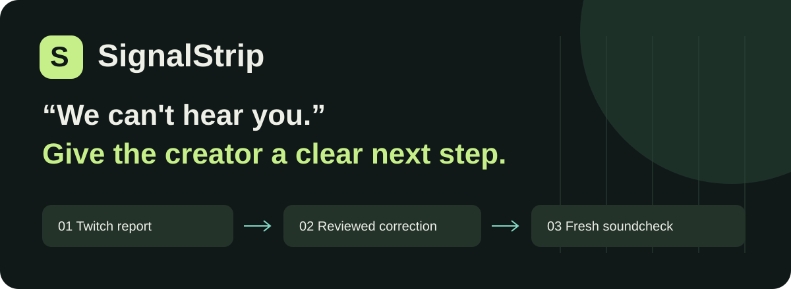
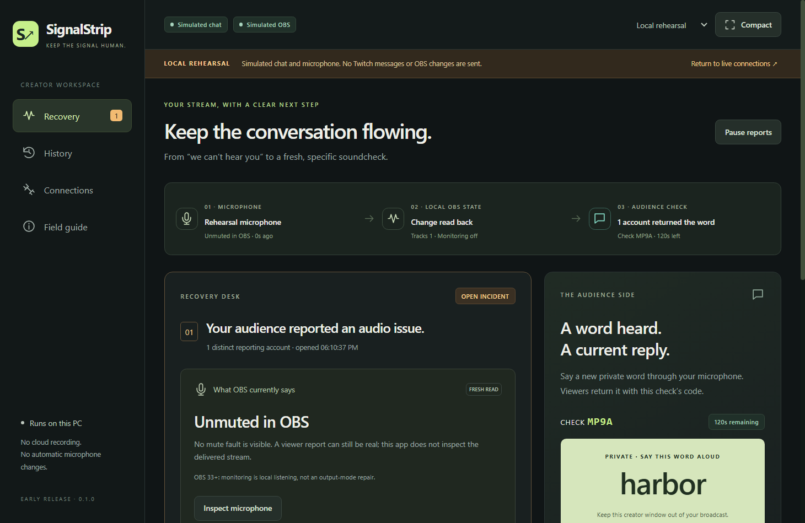
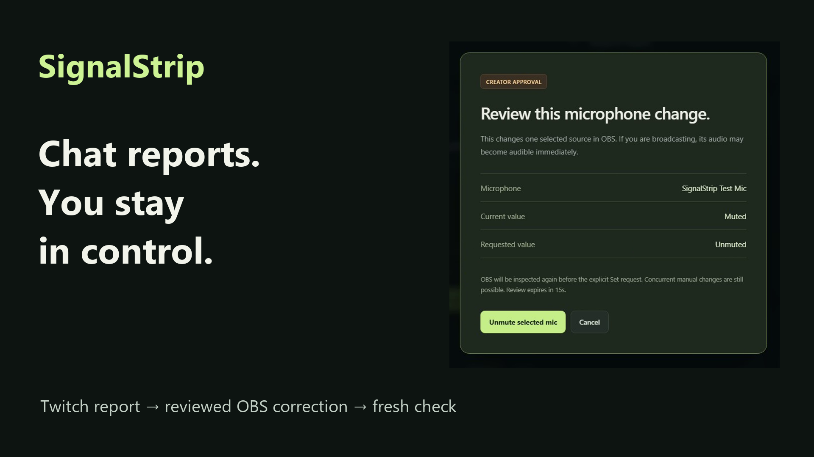

<p align="center"></p>

<p align="center"><strong>A Twitch audio report. A correction you review. A fresh soundcheck.</strong><br>Windows desktop companion · OBS + Twitch EventSub · Built with OpenAI Codex</p>

<p align="center"><a href="#try-it-in-two-minutes">Try the demo</a> · <a href="docs/JUDGE_GUIDE.md">Judge guide</a> · <a href="docs/ARCHITECTURE.md">Architecture</a> · <a href="docs/VERIFICATION.md">Evidence</a> · <a href="docs/SETUP.md">Setup</a></p>

## An audio complaint needs a next step

“We can’t hear you” tells a creator something is wrong. It doesn’t identify the selected microphone’s state, and an old “sounds good” can refer to an earlier moment.

SignalStrip connects the recovery steps in one private workspace. A viewer sends `!signal audio`. The creator inspects one selected OBS microphone, reviews an explicit unmute, and sees its value read back. A fresh check code and private spoken word give subsequent replies a specific context.


<p align="center"><sub>Screenshot: local rehearsal fixtures. This image is not evidence of an independent listener.</sub></p>

[](https://www.youtube.com/watch?v=uZQPvFm90pU)
<p align="center"><sub>Real offline-channel Twitch/OBS capture, labelled rehearsal replies, synthetic narration and actual Codex build excerpts. <a href="https://github.com/kathir-iTech/SignalStrip/releases/tag/v0.1.0-demo">Video, captions and source release</a>.</sub></p>

## The interaction

| Twitch community | Creator | SignalStrip |
|---|---|---|
| Reports with `!signal audio` | Inspects the selected mic | Opens one incident and reads current OBS state |
| Waits for the creator | Reviews the exact before/after change | Rechecks, sends an explicit Set, then reads back |
| Replies `!heard CODE word` | Says the private word through the mic | Matches only the current code and word |
| Can report continuing trouble | Chooses the outcome | Keeps current replies and contrary reports visible |

Every correction needs creator approval. Public replies describe responding accounts; they do not establish every viewer’s experience. The app does not transcribe speech.

## Try it in two minutes

**No Twitch account or OBS connection is needed for the labelled rehearsal.** Use Windows x64 with Node 24.18.1 / npm 11.16.0:

```powershell
npm ci
npm run build
powershell -NoProfile -File scripts/Judge-Demo.ps1
```

1. Select **Local rehearsal** at the top.
2. Click **Viewer reports audio** in the rehearsal controls.
3. Choose **Review unmute → Unmute selected mic**. Observe **Local value read back**.
4. Choose **Ask for a soundcheck**, then **Return current word** in the rehearsal controls.
5. Close **Current word returned** and open **History**.

These are simulated inputs through the application workflow. For real Twitch/OBS use, follow [the connection guide](docs/SETUP.md). The app requests only `user:read:chat`; no stream key, client secret, paid inference, or viewer installation is required.

**Windows distribution status:** the portable ZIP was built, but Windows Application Control blocked the final standalone executable on the development PC. Use the source path above for review. An earlier package passed a rehearsal; final standalone launch is not claimed verified. Keep security protections enabled.

## Built for uncertain moments

- Reports never invoke microphone setters.
- Unknown results require inspection; the setter is not blindly retried.
- Old replies cannot confirm a new check. Replacing an active code requires confirmation.
- Chat gaps invalidate checks; moderator deletions withdraw contributions.
- Restart recovers history without replaying changes.
- The public OBS card contains instructions and a code, never the answer word.

**OBS 33 compatibility:** old Monitor Only behavior changed. SignalStrip disables that legacy repair on 33+, retaining unmute, readback, and fresh-check interaction. Installed-version evidence covers OBS 33.0.0 / WebSocket 5.7.6; earlier-version monitoring repair remains unverified.

## What has actually been verified

| Check | Result |
|---|---|
| Automated behavior and boundary tests | 34 passed; rerun during the 28 October submission audit |
| TypeScript and production compilation | Passed during that audit |
| Actual offline-channel Twitch report → actual OBS unmute/readback | Verified 26 October; recorded again 28 October |
| Final source app connected to Twitch and OBS | Verified 26 October; recorded again 28 October |
| Independent listener / delivered broadcast audio | Not verified |
| Final standalone EXE on the development PC | Blocked by Application Control |

The [verification record](docs/VERIFICATION.md) distinguishes actual integrations from fixtures. [Limitations](docs/LIMITATIONS.md) include concurrent OBS control, copyable replies, and untested audience scale. No measured advantage over manual controls or adoption claim is made.

## Built with Codex

Codex helped implement the Electron/TypeScript app, React interface, incident reducer, OAuth/EventSub lifecycle, OBS adapter, protected storage, tests, and packaging. Actual development exposed changed OBS 33 monitoring behavior and a late-event readback race. The resulting guards and regression tests are in [electron/obs.ts](electron/obs.ts) and [tests/obs.test.ts](tests/obs.test.ts).

```text
Twitch EventSub ──→ incident reducer ──→ private creator UI
                         ↑                       │ reviewed approval
Selected mic ←── OBS adapter ←───────────────────┘
                         └──→ sanitized public soundcheck card
```

```powershell
npm run check      # behavior tests + typecheck + production build
npm run test:ui    # isolated Electron rehearsal
npm run package    # Windows ZIP; subject to host application policy
```

## Review the project

| Start here | Details |
|---|---|
| [Judge guide](docs/JUDGE_GUIDE.md) | Short review path and expected outcomes |
| [Setup](docs/SETUP.md) | Twitch, OBS, public card, storage, removal |
| [Architecture](docs/ARCHITECTURE.md) | Effect boundaries and state recovery |
| [Verification](docs/VERIFICATION.md) | Performed checks and negative results |
| [Third-party inventory](docs/THIRD_PARTY.md) | Dependencies, licenses, original artwork |

Windows-backed safeStorage protects credentials. Private words and audio are not recorded. Closed history defaults to seven-day retention; an open incident remains until closed or cleared. Private local data and generated builds are excluded from Git.

MIT licensed. Created for the Codex x TwitchCon Hackathon. The linked release contains the demo film, captions and source; the tested review path remains the source rehearsal. The [public YouTube demo](https://www.youtube.com/watch?v=uZQPvFm90pU) is available; response matching in the film uses labelled rehearsal.
